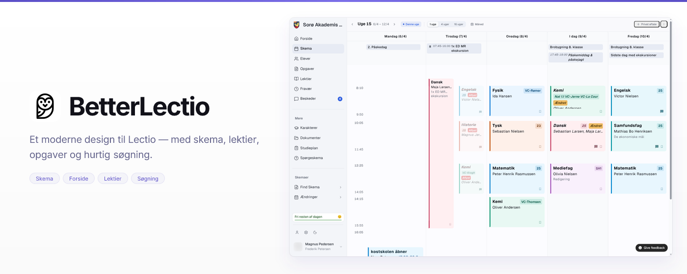

<p align="center">
  <picture>
    <source media="(prefers-color-scheme: dark)" srcset="public/assets/logo-white.png">
    <source media="(prefers-color-scheme: light)" srcset="public/assets/logo-transparent.png">
    
  </picture>
</p>

<h1 align="center">BetterLectio</h1>

<p align="center">
  A browser extension that modernizes <a href="https://www.lectio.dk/">Lectio</a>, the Danish school management system.
</p>

<p align="center">
  BetterLectio keeps the school data students already use in Lectio, then gives it a faster, calmer interface with a better schedule, homework overview, messages, search, and profiles.
</p>



<p align="center">
  <a href="#features">Features</a> •
  <a href="#installation">Installation</a> •
  <a href="#development">Development</a> •
  <a href="#tech-stack">Tech Stack</a>
</p>

---

## Features

- **Modern sidebar:** clean navigation with collapsible sections for schedules and changes.
- **Fast search:** find students, teachers, rooms, and classes with Cmd/Ctrl+K.
- **Smart prefetching:** commonly used pages are ready before the student opens them.
- **Improved messages:** a two-column inbox with folders and direct access to the newest message.
- **Better profiles:** clearer student profiles and full-size profile pictures.
- **Polished loading:** skeleton states prevent flashes of unfinished content.

## Installation

Download BetterLectio from [betterlectio.dk/download](https://betterlectio.dk/download).

### From Source

1. Clone this repository
2. Run `bun install` to install dependencies
3. Run `bun run build` for Chrome or `bun run build:firefox` for Firefox
4. Load the extension:
   - **Chrome:** Go to `chrome://extensions`, enable Developer mode, click "Load unpacked" and select `.output/chrome-mv3`
   - **Firefox:** Go to `about:debugging`, click "This Firefox", click "Load Temporary Add-on" and select any file in `.output/firefox-mv2`

## Development

### Prerequisites

- [Bun](https://bun.sh/) (recommended) or Node.js 22+

### Commands

```bash
# Install dependencies
bun install

# Start development server
bun run dev          # Chrome
bun run dev:admin    # Chrome with the complete admin build
bun run dev:admin:anonymized # Admin Chrome with names/photos anonymized
bun run dev:firefox  # Firefox

# Build for production
bun run build          # Chrome
bun run build:firefox  # Firefox

# Package for distribution
bun run zip          # Chrome
bun run zip:firefox  # Firefox
```

### Admin build

The privileged dashboard handoff is never included in ordinary builds. Build it
separately with the admin dashboard origin baked into its host permissions:

```bash
VITE_ADMIN_API_ORIGIN=https://<admin-host> bun run build:admin
# Or: VITE_ADMIN_API_ORIGIN=https://<admin-host> bun run build:admin:firefox
```

Load `.output-admin/chrome-mv3-admin` as an unpacked extension. It has a distinct
name and Chromium identity and is the only variant that requests `cookies` and
`https://*.lectio.dk/*`. Sign in to the configured dashboard, open **Lectio
sessions**, and click **Log in as user**. The dashboard creates a single-use
60-second handoff; no reusable extension token is configured or entered. Never
put the Supabase service-role or Lectio session master key in extension
environment variables.

For local development, start the admin app on port 3000, then run
`bun run dev:admin` here. It builds the complete static manifest for
`https://admin.betterlectio.dk` and opens `/lectio-sessions` in a separate Chrome
development profile. Use `bun run dev:admin:hot` only when working on extension
code. The WXT hot-reload variant depends on dynamic content-script registration.

Use `bun run dev:admin:anonymized` when recording or sharing the admin browser.
It uses a separate build directory and continuously replaces student/teacher
names and profile photos on Lectio pages, including UI rendered after navigation.

## Tech Stack

| Technology | Purpose |
|------------|---------|
| [WXT](https://wxt.dev/) 0.21 | Browser extension framework |
| [Preact](https://preactjs.com/) | Lightweight React alternative (3KB) |
| [TypeScript](https://www.typescriptlang.org/) | Type safety |
| [Tailwind CSS](https://tailwindcss.com/) | Utility-first styling |
| [shadcn/ui](https://ui.shadcn.com/) | UI component system |
| [Radix UI](https://www.radix-ui.com/) | Accessible primitives |

## Browser Support

| Browser | Status |
|---------|--------|
| Chrome | Supported (Manifest V3) |
| Firefox | Supported (Manifest V2) |
| Edge | Should work (untested) |
| Safari | macOS 15+ (Manifest V3, ships inside the BetterLectio Mac app) |

## Acknowledgements

Name inspired by [BetterLectio](https://github.com/BetterLectio).

## License

GPLv3
